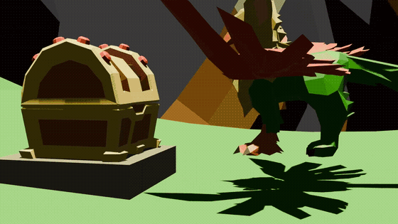
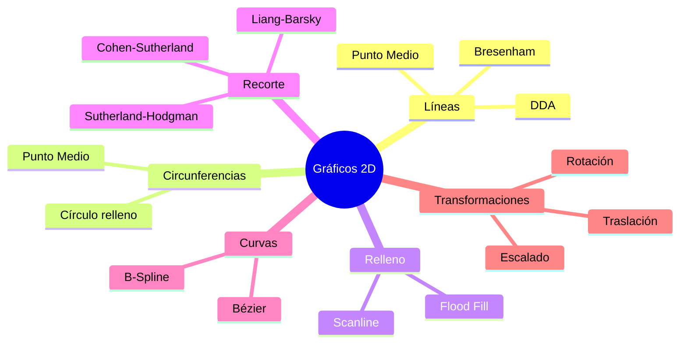
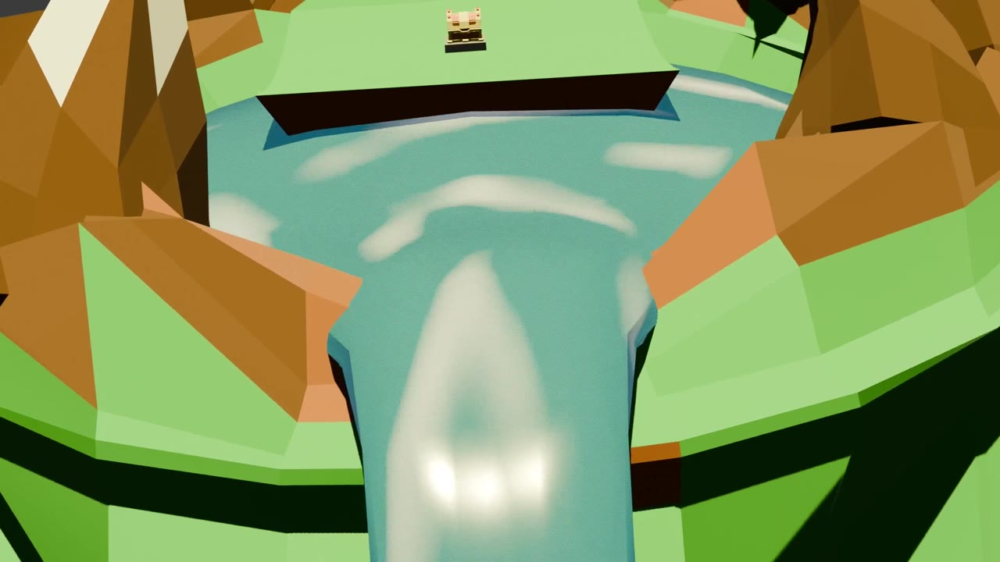
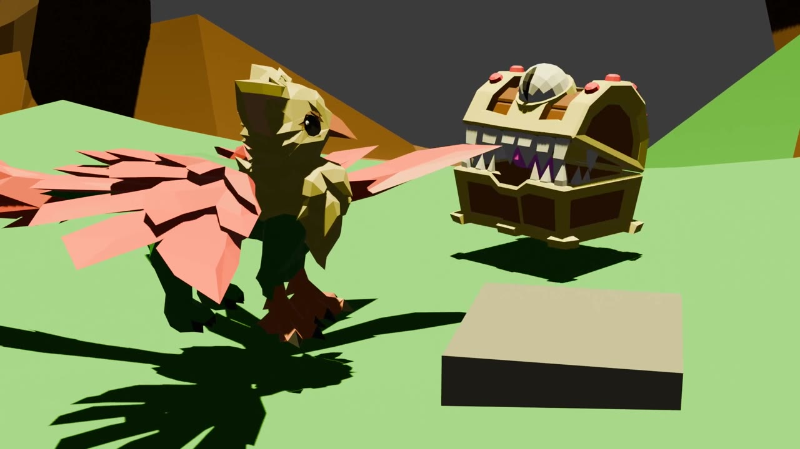
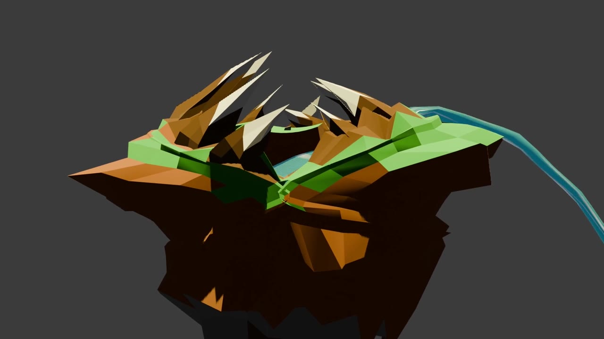
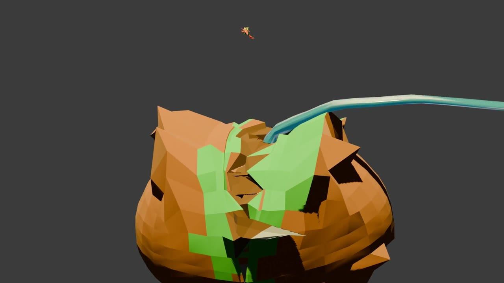
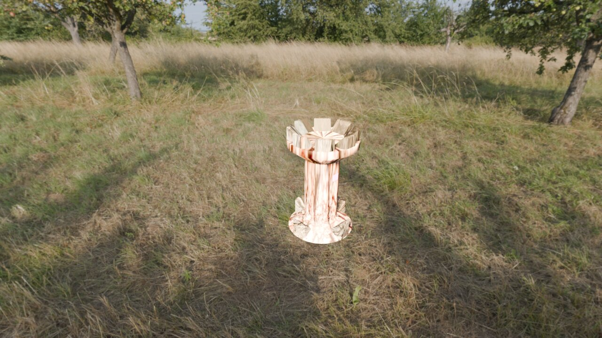
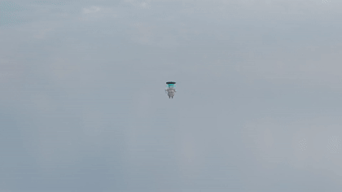

# Computación Gráfica

### De los algoritmos de rasterización a un editor 3D con OpenGL y animación en Blender

---

## Descripción

Portafolio de la asignatura **Computación Gráfica** (Ingeniería de Software, ESPE). Reúne el recorrido completo de la materia: implementación desde cero de los **algoritmos clásicos de gráficos 2D**, un **editor de escenas 3D** sobre OpenGL y proyectos de **modelado, texturizado, rigging y animación** en Blender.

## Contenido

| # | Proyecto | Tecnología | Qué implementa |
|---|---|---|---|
| 01 | [Figuras y transformaciones](2D/01-Figuras-y-Transformaciones) | C# · GDI+ | Construcción de figuras geométricas compuestas y transformaciones 2D: traslación, rotación y escalado |
| 02 | [Algoritmos de rasterización](2D/02-Algoritmos-de-Rasterizacion) | C# · GDI+ | Líneas (**DDA**, **Bresenham**, **Punto Medio**), circunferencias, **relleno** (Flood Fill, Scanline) y **recorte** (Cohen-Sutherland, Liang-Barsky, Sutherland-Hodgman) |
| 03 | [Curvas](2D/03-Curvas) | C# · GDI+ | Curvas de **Bézier** y **B-Spline** con puntos de control interactivos |
| 04 | [Velocímetro](2D/04-Velocimetro) | C# · GDI+ | Instrumento animado dibujado con primitivas y trigonometría |
| 05 | [Editor de escenas 3D](3D-motor/WinAppProyecto2) | C# · OpenTK (OpenGL) | Escena con objetos tipo *GameObject* (cubo, esfera, pirámide, cilindro, cono), iluminación, transparencia, grilla, cámara orbital con mouse y selección de puntos en el espacio 3D |
| 06 | [La Isla Fauce](#la-isla-fauce-cortometraje-3d) | Blender | Cortometraje animado de 1 minuto: guion, storyboard, modelado, texturas, rigging y animación |
| 07 | [Personaje 3D](#más-trabajo-en-blender) | Blender | Modelado y animación de un personaje |

## Algoritmos 2D implementados

Los algoritmos de rasterización se implementaron **píxel a píxel**, sin recurrir a las primitivas de dibujo de alto nivel del framework, para estudiar su funcionamiento interno.

## La Isla Fauce · Cortometraje 3D

> Gale, un grifo, descubre una isla flotante que en realidad es un **Mimic gigante**. Una historia corta de suspenso, comedia y acción.

<table>
  <tr>
    <td></td>
    <td></td>
  </tr>
  <tr>
    <td></td>
    <td></td>
  </tr>
</table>

- **Video completo:** [`media/La_Isla_Fauce_cortometraje.mp4`](media/La_Isla_Fauce_cortometraje.mp4)
- **Informe** (guion técnico, storyboard de 12 paneles, modelado, texturas y rigging): [`docs/Informe_La_Isla_Fauce.pdf`](docs/Informe_La_Isla_Fauce.pdf)
- Archivos `.blend` en la sección [Releases](../../releases)

**Pipeline:** guion → storyboard → modelado de 3 personajes (Gale, Mini-Mimic, Mimic gigante) → materiales y texturas → rigging → animación → render y edición con audio.

## Más trabajo en Blender

<table>
  <tr>
    <td width="50%"></td>
    <td width="50%"></td>
  </tr>
  <tr>
    <td align="center">Torre medieval con texturas de piedra y madera</td>
    <td align="center">Modelado y animación de personaje (fan art académico)</td>
  </tr>
</table>

 Proceso de modelado y animación del personaje: [`docs/Informe_Personaje_3D.pdf`](docs/Informe_Personaje_3D.pdf)

## Ejecutar los proyectos de C#

1. Abrir el archivo `.sln` de cada carpeta en **Visual Studio 2022**.
2. Restaurar paquetes NuGet (el editor 3D usa `OpenTK 3.1` y `OpenTK.GLControl`).
3. Compilar y ejecutar (`F5`).

## Créditos

- **Marco Adrián Padilla Triviño** ([@Adrizzx](https://github.com/Adrizzx)): proyectos 2D, editor 3D y modelado en Blender.
- *La Isla Fauce* desarrollado junto a **Ricardo Laínez Suárez** y **Erick Tufiño Ortiz**.

Computación Gráfica · Universidad de las Fuerzas Armadas ESPE · 2025-2026

